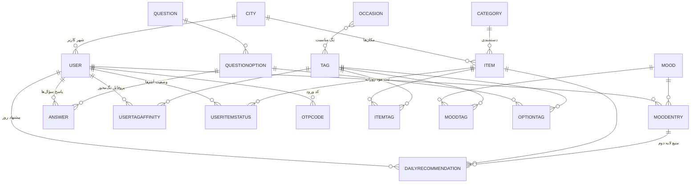

# مدل داده حالینو — ERD

سه اپ: `accounts` (کاربر و شهر)، `content` (محتوا و مناسبت)، `journey` (مود، سؤال، وضعیت، پیشنهاد).

## چرا این شکلی

**تگ مرکز ثقل کل سیستم است.** پاسخ آنبوردینگ، مود، و آیتم — هر سه از یک فضای تگ مشترک استفاده می‌کنند. موتور پیشنهاد فقط یک کار می‌کند: وزن تگ‌های کاربر را با وزن تگ‌های آیتم ضرب داخلی می‌گیرد. دسته‌بندی فقط برای نمایش و فیلتر است، نه برای تطبیق.

**`UserTagAffinity` همان چیزی است که «ریسک ۳» سند را حل می‌کند.** خروجی تست اولیه یک برچسب مبهم مثل «درون‌گرا» نیست؛ چند ردیف `(کاربر، تگ، وزن)` است که مستقیماً قابل مصرف است. بازخورد کاربر هم همین جدول را به‌روز می‌کند — پس «کاربر فیلم بیشتر می‌بیند پس فیلم بیشتر پیشنهاد می‌شود» بدون هیچ کد اضافه‌ای کار می‌کند.

**یک `Question` برای هر دو نوع سؤال.** سؤال آنبوردینگ و سؤال روزانه فقط در فیلد `scope` فرق دارند. این نصف مدل‌ها و نصف ویوها را حذف می‌کند.

**`is_serial` روی `Category` نه روی `Item`.** قانون «تا کتاب تمام نشده کتاب جدید نده» یک بار نوشته می‌شود و کتاب، سریال و دوره را با هم پوشش می‌دهد.

**`needs_city` روی `Category`.** گیت شهری دسته‌محور است نه آیتم‌محور — یعنی کل دسته «کافه/مکان» برای شهرهای پشتیبانی‌نشده خاموش می‌شود و بقیه دسته‌ها باز می‌مانند. دقیقاً همان چیزی که در سند خواسته شده (مشهد: کافه نه، بقیه بله).

**`DailyRecommendation` با `unique_together(user, date, item)`.** پیشنهاد یک بار در روز تولید و ذخیره می‌شود؛ رفرش صفحه چیزی را عوض نمی‌کند. فیلد `source` مشخص می‌کند این ردیف لایه اول است یا دوم، و `mood_entry` فقط برای لایه دوم پر می‌شود — همین بعداً تحلیل «کدام مود چه پیشنهادی گرفت و بازخوردش چه بود» را مجانی می‌دهد.

**`Mood` جدول است، نه choices.** چون مختصات عددی `energy` و `valence` را نگه می‌دارد. نمودار تقویم از این دو عدد ساخته می‌شود و اضافه‌کردن مود جدید یک ردیف است.

## نکته‌ای که اگر رعایت نشود پروژه را عقب می‌اندازد

مدل `User` سفارشی **باید قبل از اولین `migrate` وجود داشته باشد**. اگر اول با `User` پیش‌فرض جنگو migrate کنی و بعد بخواهی عوضش کنی، تنها راه عملی پاک‌کردن دیتابیس و همه‌ی migrationهاست. چون ورود با OTP است و شماره موبایل کلید هویت است، از همان `startapp` اول این را بگذار.
